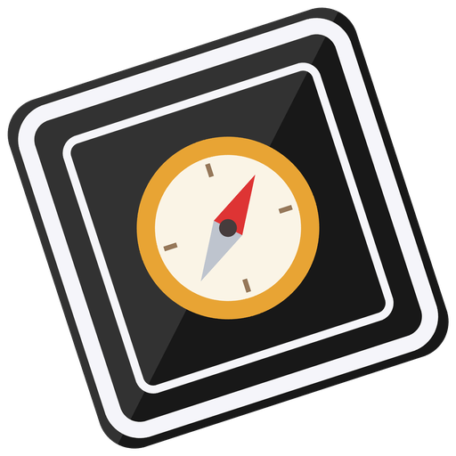

<p align="center">
  
</p>

<h1 align="center">GuideStrap</h1>

<p align="center">
  A free Roblox launcher for Windows: more FPS, mods, friends, one-click server joins, Discord status and a crash helper.
  <br><br>
  <a href="https://github.com/guideships/GuideStrap/releases/latest"><b>Download the latest version</b></a>
  ·
  <a href="https://guideships.github.io/GuideStrap/">Website</a>
</p>

---

## What it does

GuideStrap replaces Roblox's normal launcher. It downloads Roblox straight from Roblox's own servers, keeps it updated, and starts it with your settings applied.

**Graphics and FPS**
- **Recommended settings:** checks your PC (graphics card, memory, screen) and picks graphics settings for it
- A slider from *Max FPS* to *Max Graphics*, or every setting on its own
- **FPS cap:** any number you want, set in Roblox's own settings
- **Roblox priority:** give Roblox more CPU time

**FastFlags**
- An editor for flags on Roblox's official allowlist (anything else is skipped, since Roblox ignores it)
- Paste a whole JSON list at once; if a flag is already set, you choose whether to overwrite or keep it

**Mods**
- **Mod gallery:** crosshairs, cursors, skies and sound packs in one click ([add your own](gallery/README.md))
- Death sound, footstep and jump sounds (muted or your own), and sound packs
- Shift lock crosshair and mouse cursors: presets or your own image
- Custom sky packs and a custom font for all in-game text
- **Setups:** save your graphics and mods as e.g. "BedWars", and link a setup to a game so it turns on by itself
- A mods folder for anything else

**Playing**
- **Rejoin last server**, **Server hop** and **Small server** (the emptiest one)
- **Friends:** see who's online and what they're playing, join them, and get a popup when they start a game
- Recent games on the Play page, and switching between saved accounts in one click
- **Roblox status check:** tells you if Roblox is down (or you're offline) before launching

**Discord and streaming**
- Discord status (off until you turn it on): show your game, the account you're using, and a **Join server** button for friends
- **Streamer mode:** hides account names and server location in GuideStrap and on Discord
- Session summary after you close Roblox

**Other**
- **Crash helper:** if Roblox crashes, it explains why and gives one-click fixes
- 7 languages: English, Español, Português, Français, Deutsch, Türkçe and Filipino
- Black and Purple themes, and your own picture on the start screen
- Starts quietly with Windows if you want, and steps aside while you play
- Settings profiles you can export and share, cache cleaner and one-click Roblox repair
- Updates itself, with a "What's new" list after every update
- Uninstall from Settings, with the option to keep your settings for a reinstall

## Is it safe?

- GuideStrap never touches the game while it's running. It only changes files and settings that Roblox reads on its own when it starts, the same way Bloxstrap and Fishstrap work. It isn't an exploit.
- **Your normal Roblox install is never changed.** Everything happens in GuideStrap's own copy of Roblox, so opening Roblox without GuideStrap always gives you the original game. You can also hand the website's Play buttons back to normal Roblox from Settings.
- Saved logins are encrypted with Windows and only work for your Windows user on your PC. Never share your GuideStrap folder.
- The code is all here, so anyone can check what it does.

## Install

1. Download `GuideStrap.exe` from [Releases](https://github.com/guideships/GuideStrap/releases/latest).
2. Run it. Windows may warn you because the app isn't signed yet; click **More info → Run anyway**.
3. Pick your language and options, then press **Install**.
4. Press **Launch Roblox**. The first launch downloads Roblox, which takes a minute.

Optional: in **Settings**, turn on **Open Roblox links with GuideStrap** so Play buttons on roblox.com use it too.

## Building it yourself

You need Visual Studio 2026 (or the .NET 10 SDK) on Windows.

```
git clone https://github.com/guideships/GuideStrap.git
cd GuideStrap
dotnet build
```

To make the single `GuideStrap.exe` used for releases:

```
dotnet publish GuideStrap -c Release
```

It ends up in `GuideStrap/bin/Release/net10.0-windows/win-x64/publish/`.

The code is split by area: `Form1.*.cs` (settings window, one file per page), `Forms/` (other windows), `UI/` (theme and controls), `Roblox/` (installing, launching, mods, Discord, friends), `Core/` (settings, accounts, setup, updates) and `Localization/` (languages).

## Credits

Made by **[guideships](https://github.com/guideships)**. Inspired by [Bloxstrap](https://github.com/bloxstraplabs/bloxstrap) and [Fishstrap](https://github.com/fishstrap/fishstrap).

GuideStrap is a fan project and isn't affiliated with or endorsed by Roblox Corporation. The source code is public so you can see what it does, but all rights are reserved: please don't copy, re-upload or sell it. See [LICENSE.txt](LICENSE.txt).
